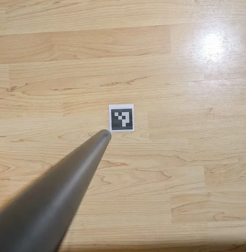
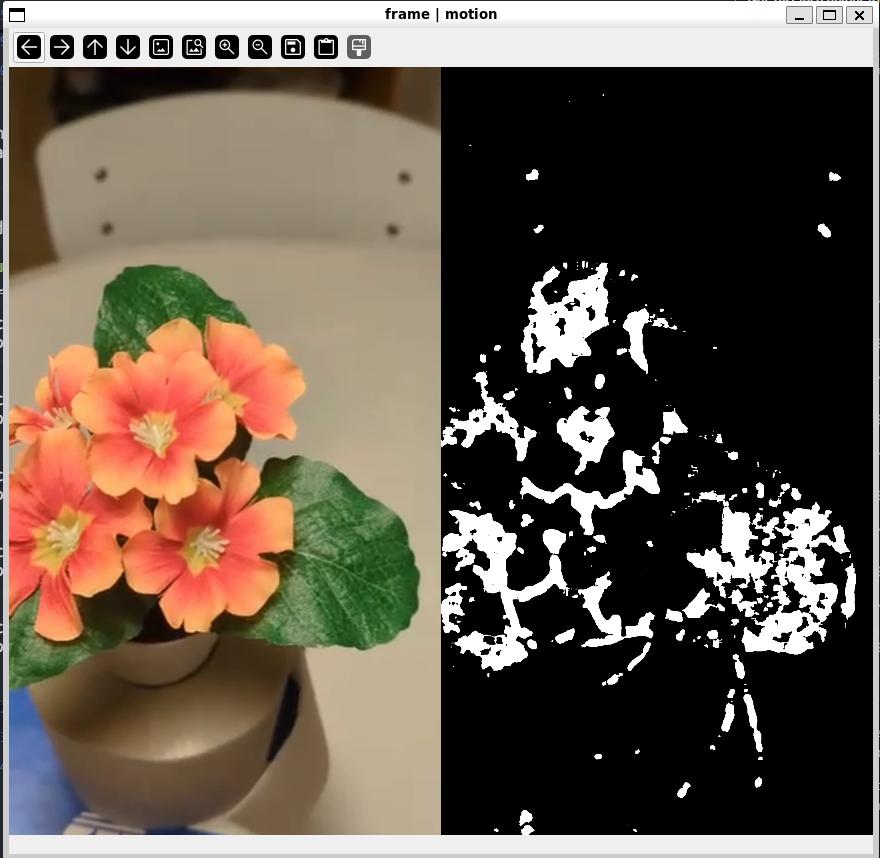
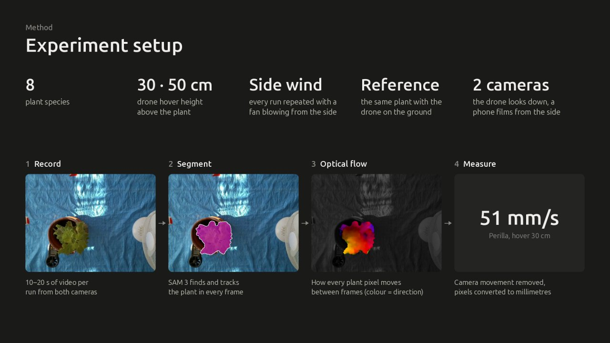

# DJI Tello downwash on plants

We hovered an 80 g DJI Tello 30 and 50 cm above 8 potted plants and used optical flow to measure how much the leaves move. This matters because nano drones are a natural fit for close-range multispectral imaging (NDVI, NIR) of single plants, and at that range the plant sits right inside the drone's downwash.

▶ **Video:** https://youtu.be/NWQLOaltLjE


## Key findings

- **The downwash moves a plant about as much as a desk fan does.** In still air, hovering made the leaves move about 30–50× more than with the drone not flying (28× at 30 cm, 48× at 50 cm). Every plant moved more (8 of 8, p = 0.008). The fan alone gave 29×.
- **The leaves deform, not just sway.** How much the plant's outline changes over 0.1 s went up about 10×.
- **When the air is already moving, the drone adds about 2×.** With the fan on, hovering roughly doubled leaf motion (1.9–2.5×).
- **Hovering at 50 cm was no gentler than at 30 cm.** We found no clear difference between the two heights.

In other words, a nano drone hovering over a plant to image it is photographing a canopy that is moving and changing shape.

## Why this matters for NDVI and NIR data

NDVI = (NIR − Red) / (NIR + Red) compares how much near-infrared and red light a surface reflects. Healthy leaves reflect a lot of NIR and absorb red, so NDVI is high on leaves and low on soil. Close-range NDVI assumes the leaves hold still while the bands are captured and between one visit and the next. Our results suggest that assumption fails as soon as the drone hovers over the plant.

We did not measure NDVI in this project. These are the effects we expect, to be tested next:

- **Band misregistration.** Many small multispectral cameras capture red and NIR through separate lenses, or one after the other. A leaf moving at 30 mm/s, typical for our hover runs, shifts 1.5 mm in 50 ms. That is about 4 pixels on the Tello camera at 30 cm. The red and NIR pixels then land on different parts of the leaf, or on leaf in one band and soil in the other, which gives false NDVI values along leaf edges.
- **Motion blur.** Within one exposure, leaf edges smear into the background. This mixes leaf and soil pixels and pulls NDVI towards the soil value.
- **Leaf angle.** How much light a leaf reflects depends on its angle to the light and the camera. Downwash flattens and tilts leaves, and flips some over to show their undersides, which reflect differently.
- **Canopy gaps.** When the leaves are pushed apart, more soil and pot show through, and the plant's average NDVI drops.
- **Noise between visits.** The same plant can give a different NDVI from frame to frame and from flight to flight. That noise can hide the slow changes, such as stress, disease or growth, that a survey is meant to detect.

Possible fixes a follow-up could test: hover well above 50 cm and zoom in, use a snapshot camera that captures all bands at once with a short exposure, image while flying past instead of hovering, or use this repo's optical-flow pipeline to keep only the frames where the leaves are still.

## What we did

### Plants and conditions

We filmed 8 potted plants: perilla, burdock, lemon balm, calendula, wild strawberry, avocado, palledium and asparagus. Each plant was filmed in six conditions:

| | Fan off | Fan on |
|---|---|---|
| **Reference:** drone mounted above the plant, motors off | ✓ | ✓ |
| **Hover 30 cm** above the plant | ✓ | ✓ |
| **Hover 50 cm** above the plant | ✓ | ✓ |

The reference is each plant's own baseline: how much it moves in room air, and how much motion the pipeline reports when nothing is happening. A desk fan blowing from the side stood in for wind. Each run lasts 10–20 s and was filmed by two cameras at once, giving 88 clips (48 from the drone, 40 from the phone).

### Cameras and calibration

- **Drone camera:** the Tello's own camera looking down, about 30 fps, recorded together with flight telemetry at 10 Hz ([drone_control/DownwashDataRecording/](drone_control/DownwashDataRecording/)).
- **Phone camera:** a Pixel 7a on a tripod filming from the side at 60 fps. A 50 mm ArUco marker stands next to the plant, in the same plane as the leaves.

Optical flow measures motion in pixels. To compare runs filmed from different distances, we convert it to millimetres:

```
movement (mm) = optical flow (px) / scale (px/mm)
```

We first calibrated the Pixel 7a's main camera with the ArUco marker on an IKEA table 750 mm from the camera. The table was the only object at hand with a known size ([calibrate_camera.py](drone_control/helpers/calibrate_camera.py)). The estimated focal length is 2818 px, which gives a scale of 3.76 px/mm at 750 mm. In the final pipeline the phone's scale is measured in every clip, from the marker in the first 30 frames, so moving the tripod between runs doesn't matter. The drone camera's scale comes from the hover height and the camera's focal length, which we assumed (840 px) rather than calibrated.

The scale is only exact for things in the marker's plane, and optical flow only sees motion across the image, not towards or away from the camera. So every motion number here is the 3D leaf motion projected onto the image.

### From video to leaf motion

Our first prototype ([calculate_optical_flow.py](drone_control/helpers/calculate_optical_flow.py)) ran Farneback optical flow over the whole frame and reported mean and RMS flow. In its motion mask (right image below, white means moving more than 1 px per frame), every pixel in the frame counts, so specks in the background and camera shake go into the average. On the drone camera, which moves by itself while hovering, the whole frame would light up. The final pipeline (`src/`) therefore isolates the plant and removes the camera's own motion:

1. **Find the plant.** Click on the plant once per clip ([annotate.py](src/annotate.py)). SAM 3 then tracks it through every frame ([generate_tracking_mask.py](src/generate_tracking_mask.py)), with the work split across two GPUs.
2. **Measure motion.** Compute DIS optical flow between consecutive frames.
3. **Remove camera motion.** Fit the background's shift, rotation and zoom from pixels outside the plant, using RANSAC to ignore a fluttering background, and subtract it from the plant's flow. This matters most for the hovering drone.
4. **Summarise.** Average the remaining plant motion per frame, convert it to mm/s, and average per clip ([metrics.py](src/helpers/metrics.py)).

<p>
  
  
</p>

| Metric | What it measures |
|---|---|
| Leaf motion (mm/s) | Mean optical flow over the plant's pixels, after removing camera motion |
| Size-normalised motion (1/s) | The same in pixels, divided by the plant's size in pixels. It needs no mm scale |
| Peak motion (mm/s) | 95th percentile of the plant's flow, which captures the fastest leaves (we used this instead of RMS) |
| Shape change | 1 − overlap (IoU) between the plant's outline 0.1 s apart |
| Change vs reference | Each metric divided by the same plant's reference value |

**Statistics.** For each plant we divide the hover value by the reference value from the same camera with the same fan setting, then take the median across plants. To test whether the plants moved more, we run a Wilcoxon signed-rank test on the log ratios, whenever at least 6 plants have a value. With 8 plants, p = 0.008 is the smallest possible result: it means all 8 changed in the same direction.



## What we found

Median across plants. × means "times as much motion as the comparison". 8/8 means 8 of 8 plants moved more. p is from the Wilcoxon test.

| Comparison | Drone camera, mm/s | Drone camera, size-normalised | Phone camera, size-normalised |
|---|---|---|---|
| Hover 30 cm vs reference, fan off | 28× (8/8, p = 0.008) | 41× (8/8, p = 0.008) | 9× (5/5) |
| Hover 50 cm vs reference, fan off | 48× (8/8, p = 0.008) | 49× (8/8, p = 0.008) | 14× (4/4) |
| Fan on vs off, drone not flying | 29× (8/8, p = 0.008) | 27× (8/8, p = 0.008) | 7× (5/5) |
| Hover 30 cm vs reference, fan on | 1.9× (5/8, p = 0.11) | 2.5× (8/8, p = 0.008) | 2.0× (5/5) |
| Hover 50 cm vs reference, fan on | 2.1× (7/7, p = 0.016) | 2.2× (7/7, p = 0.016) | 2.3× (4/4) |
| Hover 30 cm vs 50 cm, fan off | 0.77× (0/8, p = 0.008) | 0.92× (3/8, p = 0.55) | 0.84× (2/7, p = 0.38) |

The phone column has fewer plants because some runs have no phone clip (calendula, avocado and asparagus have no phone reference), so most phone rows have no p-value.

- **Typical speeds (drone camera, median of plants):** 0.8 mm/s at reference, 22–37 mm/s when hovering, 23 mm/s with only the fan, and 40–42 mm/s with the fan and the drone together.
- **Shape change** went up 9.8× at 30 cm and 9.6× at 50 cm (8/8, p = 0.008 for both).
- **Plants differ a lot.** Hovering with the fan off, lemon balm moved the most (78–104 mm/s), then perilla (51–65 mm/s). Burdock, palledium and asparagus moved the least (13–29 mm/s).
- **30 vs 50 cm.** In mm/s, the drone camera says every plant moved less at 30 cm. We don't trust that result. The drone camera converts pixels to mm using the hover height, and with that scale the same plant measures about 1.3× bigger at 50 cm than at 30 cm (median of 8 plants). So the real distances were not in a 50:30 ratio: the Tello's height hold is coarse, and a canopy is not a flat plane. The size-normalised measure, which needs no scale, shows no clear difference on either camera. Our reading is that 50 cm was at least as hard on the plant as 30 cm.


## Why we think it happens

We didn't measure airflow, so these are our explanations, not tested results.

1. **A nano drone's downwash is about as strong as a desk fan.** Ideal momentum theory for an 80 g Tello on four 3-inch (76 mm) rotors gives an air speed of about 4 m/s at the rotors: v = √(T / 2ρA), with thrust T = 0.78 N and rotor area A ≈ 0.018 m². That is in the range of a desk fan, which fits the drone alone (28–48×) and the fan alone (29×) moving the plants by similar amounts.
2. **The jet is turbulent and moves around.** The air comes from four rotors, pulses with every blade pass, and follows the drone as it drifts a few centimetres while holding position. The jet sweeps across the canopy instead of pushing steadily, so the leaves flutter and change shape (the ~10× shape change) instead of bending once and staying put.
3. **Wind on top of wind adds less.** With the fan on: (a) the leaves are already bent and folded into a streamlined shape, and flexible leaves catch proportionally less extra force as the wind gets stronger (Vogel, 1989); (b) the side wind bends the downwash jet away from the plant; (c) the drone tilts and drifts to hold its position against the fan, which moves its jet off-centre.
4. **50 cm is not far enough to escape the jet.** 30 and 50 cm are only about 4 and 7 rotor diameters below the drone. Over that distance the four rotor jets merge into one wider column that slows down only gradually. At 50 cm the plant may sit in the merged jet, while at 30 cm part of it may sit in the calmer air under the drone's body. That would cancel out the extra distance.
5. **Soft, light leaves move the most.** Plants with soft leaves on flexible stems (lemon balm, perilla) moved the most. Heavier, stiffer leaves (burdock) and fine, needle-like foliage (asparagus) moved the least: a stiff leaf resists the air, and fine foliage has little area to catch it.
6. **The phone sees smaller ratios (7–14× vs 27–49×).** With the drone not flying, the phone measures about as much motion on the plant as in the background, so its reference is mostly noise, and every ratio against noise shrinks. The side view also sees mostly up-and-down motion, while the drone camera looks down on leaves pushed outwards. Both cameras agree on the fan-on ratios of about 2×.

## Limitations

- **One run per condition.** The plan called for at least 3 repeats. We have one, with the fan off in `r1` and on in `r2`, so the statistics compare across plants, and we can't say how repeatable a single plant is.
- **Weak signal in 21 hover clips.** In these clips, plant motion was less than 5× the background noise, mostly for asparagus, palledium and burdock. They are flagged and kept in the analysis.
- **Hovering only.** The plan also included different speeds and flight patterns. We only tested hovering at two heights.
- **2D motion.** Optical flow measures motion across the image, not towards or away from the camera.

## Payload flight tests

To check whether the Tello could carry a small sensor, we flew it with 20–60 g of extra payload and logged its telemetry ([flight_test_harness.py](drone_control/FlightTestHarness/flight_test_harness.py), logs in [drone_control/FlightTestHarness/logs/](drone_control/FlightTestHarness/logs/)). The table covers only flights longer than a minute:

| Payload | Flights | Battery use | Highest internal temperature |
|---|---|---|---|
| 20 g | 4 | 18–24 %/min | 72–90 °C |
| 40 g | 1 | 29 %/min | 78 °C |
| 60 g | 1 | 30 %/min | 86 °C |

The Tello could fly with 60 g. At 40–60 g it used its battery about 1.5× as fast as at 20 g, and the 60 g flight lasted 2.7 minutes from a full battery to the automatic landing at 19 %. We have no full-length flight without payload to compare against.

## Run it

You need Python 3.13 and [uv](https://docs.astral.sh/uv/). Run everything from `src/`:

```bash
uv run python annotate.py               # click on the plant once per clip
uv run python generate_tracking_mask.py # SAM 3 tracks it through every frame
uv run python generate_metrics.py       # leaf motion per frame and per clip
uv run python generate_summary.py       # the stats
```

The first two steps need `torch` and `transformers`. They're commented out in `pyproject.toml`, so uncomment them on a machine with a GPU.

The raw videos (2 GB) aren't in the repo. They go in `data/p<N>_<plant>/<ReferenceRun|HoverRun>/h<height>_r<run>/`, and `r2` is always the run with the fan on. The recording and flight-test scripts are in `drone_control/`. The papers behind each step are in [references.md](references.md).

**Built with:** Python, OpenCV (DIS optical flow, ArUco markers, RANSAC), SAM 3 on PyTorch split across two GPUs, pandas, SciPy and djitellopy.

## Team

- **Kabir Tamari:** data analysis, segmentation and video
- **Binay Kumar:** experiment setup and drone code

## Acknowledgements

Special thanks to [Martin Cooney](https://www.hh.se/english/information-english/search-staff.html?person=32A50F1D-0935-4B8D-A57D-331126F8A27D) at Halmstad University, who let us use his plants and space to collect the data and guided us through the project.
