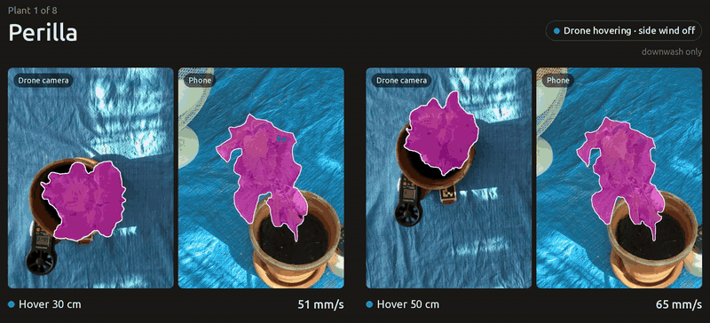
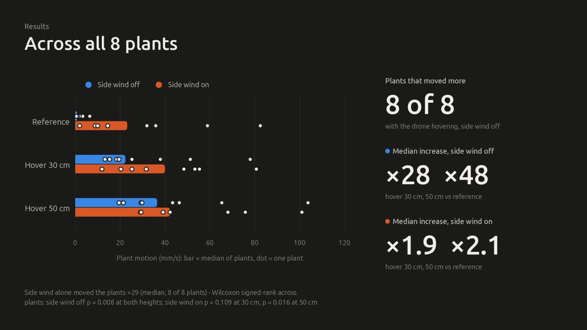

# DJI Tello downwash on plants

How much does a small drone shake the plant under it? We hovered a DJI Tello over 8 potted plants and measured how much the leaves move. Each plant was filmed with the drone on the ground, hovering 30 cm above it, and hovering 50 cm above it, each with a desk fan off and on.

▶ **Video:** https://youtu.be/NWQLOaltLjE



## What we found

Leaf motion compared with the drone sitting on the ground (median of 8 plants, drone camera):

| | Leaf motion vs drone on the ground |
|---|---|
| Drone hovering, no fan | **28×** at 30 cm, **48×** at 50 cm |
| Fan only | **29×** |
| Drone hovering, fan on | **1.9×** at 30 cm, **2.1×** at 50 cm |

Without the fan, every plant moved more with the drone hovering (8 of 8, p = 0.008). In still air the downwash moves a plant about as much as a desk fan does. When the fan is already blowing, the drone roughly doubles the motion. Also, without the fan, hovering at 50 cm moved every plant more than hovering at 30 cm did.

<p>
  
  
</p>

## How it works

1. Film each run from two angles: the drone camera looking down and a phone from the side.
2. Track the plant in every frame with SAM 3.
3. Measure how fast the leaves move with optical flow, after removing the camera's own movement.
4. Compare each run with the same plant when the drone is on the ground.

The papers behind each step are in [references.md](references.md).

## Run it

You need Python 3.13 and [uv](https://docs.astral.sh/uv/). Run everything from `src/`:

```bash
uv run python annotate.py               # click on the plant once per clip
uv run python generate_tracking_mask.py # SAM 3 tracks it through every frame
uv run python generate_metrics.py       # leaf motion per frame and per clip
uv run python generate_summary.py       # the stats
```

The first two steps need `torch` and `transformers`. They're commented out in `pyproject.toml`, so uncomment them on a machine with a GPU.

The raw videos (2 GB) aren't in the repo. They go in `data/p<N>_<plant>/<ReferenceRun|HoverRun>/h<height>_r<run>/`, and `r2` is always the run with the fan on. The recording and flight-test scripts are in `drone_control/`.

## Team

- **Kabir Tamari**: data analysis, segmentation and video
- **Binay Kumar**: experiment setup and drone code
